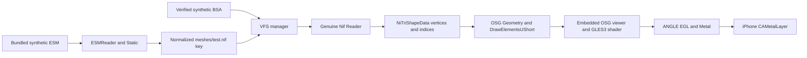

# G0C completion and first decoded-geometry rendering plan

Review baseline: `ios-port`, commit `8799e90148c3ea1985b2547fa8e9b31be19b45c2`.
This document records completion evidence and a proposed G1 experiment. It adds
no executable code, workflow, dependency, fixture or rendering integration.

## 1. G0C completion assessment

G0C is complete for synthetic NIF parsing on the physical iPhone 16 Plus.
Final PASS-screen screenshot corroboration has been obtained through the
independent review reported by the user. These evidence levels stay separate:

| Evidence | Finding | Verification boundary |
| --- | --- | --- |
| Native CI | [Build #3, run 43136166302](https://github.com/austinharvey809-dot/openmw-ios-port/actions/runs/43136166302) succeeded at the exact baseline commit. | GitHub run metadata, both jobs, individual steps and job logs inspected read-only in this review. |
| Host job `130911920445` | 46 Python tests passed; genuine host parser compilation and positive/negative execution passed. Positive output reports three records, one root, one geometry, three vertices and one triangle. | Native macOS ARM64 evidence; no device rendering inference. |
| Native job `130913003587` | 25 G0C tests passed. Configuration, G0C0 genuine executable link/inspection, G0C1 UIKit compilation/linking, G0C2 bundle validation, and G0C3 unsigned IPA packaging/independent reopening all succeeded. | Build/package evidence; CI itself did not execute on the physical phone. |
| Physical-phone exports | User reports an independent review of `nif-smoke.json` and `nif-smoke.log`: byte-for-byte identical; overall PASS; genuine parser suite completed; all six cases passed; three records, one root, one geometry, three vertices, one triangle; all 12 input snapshots unchanged; resource hashes, dependency revisions and source commit match. | Accepted as the user's independent-review evidence. The export bytes and their file digests were not supplied to this review, so they were not revalidated here and no export digest is invented. |
| Device identity | User identifies iPhone 16 Plus; exported metadata reportedly identifies `iPhone17,4`, iOS `27.2`. | Recorded as reported device metadata, not inferred from the build SDK. |
| Final PASS-screen screenshot | User confirms the actual physical-iPhone screenshot was supplied and independently reviewed: PASS — genuine OpenMW NIF execution; object `eIOSStatic`; model `TeSt.NIF`; resource `meshes/test.nif`; three vertices, one triangle and one geometry object; displayed SHA-256 matches the expected synthetic NIF hash. | Screenshot corroboration obtained according to the user's independent-review report; not a claim of direct screenshot inspection by this documentation editor. |

The six preserved cases are positive parsing, invalid header, truncation,
invalid reference, missing resource and wrong-resource bytes. See the unchanged
[probe](../../experiments/ios-openmw-nif-device-smoke/src/NifProbe.cpp) and
[export verifier](../../experiments/ios-openmw-nif-device-smoke/tools/verify_result.py).
The verifier compares parsed JSON/LOG content; the stronger byte-identity finding
above belongs to the independent review reported by the user.

This proves processing of the project's synthetic ESM/BSA/NIF fixture through
genuine OpenMW code on iPhoneOS. No real Morrowind game assets are claimed loaded
or rendered, and G0C contains no rendering or full-gameplay proof. Milestone F
and G0B remain the established physical data-processing and native host-parser
prerequisites.
Working G0C functionality and its historical README are preserved unchanged;
this separate report supplies the completion update.

## 2. Build #15 graphics audit

All nine existing files were inspected and preserved byte-for-byte. Paths below
are relative to `experiments/ios-osg-smoke/`.

| Existing file | Current work and reuse assessment |
| --- | --- |
| `CMakeLists.txt` | Static seven-library OSG viewer closure; GLES3, windowing None; dynamic verified ANGLE provider; iPhoneOS ARM64/minimum 18.0; source-specific KHR label aliases. Adds observer header and emits overlay version 3. Reuse the matched configuration concept, not an assumption that this dirty candidate has built. |
| `data/osg-lock.json` | Same exact OSG pin and four original source hashes; overlay metadata raised to 3. Must travel with matching prepared source and package validator. |
| `src/OSGScene.hpp` | Embedded single-threaded viewer, colored/textured ESSL300 programs, explicit VBO/VAO/indexed geometry, four texture profiles and six comparison cubes. Registers one watched texture/context, logs observation transitions and detaches before scene teardown. Geometry construction must be replaced in the new experiment with decoded data. |
| `src/main.mm` | UIKit/CAMetalLayer, explicit ANGLE Metal EGL display, ES3 context, one external swap, lifecycle handling, diagnostics, export and controls. New receiver/JSON/UI fields report observation state/count/path. Its clear fallback cannot count as a successful NIF render. |
| `src/MipmapObservation.hpp` (untracked) | Thread-local, one-observer, texture/context-filtered receiver; ABI check, saturating count, RAII detach and UNKNOWN/FALSE/TRUE state. No GL calls, allocation or logging inside receiver. Source review is not compiled/device validation. |
| `tools/prepare_osg.py` | Hash-checked four-file overlay on a new scratch checkout. Existing SDK/provider/windowing/LOD-bias changes plus two post-call notifications, image-helper completion and ABI symbol. Does not intercept dispatch or read GL errors. Do not apply it to the preserved clean pinned checkout. |
| `tools/package_ios.py` | Requires overlay version 3 while retaining device/SDK checks, ANGLE dependency graph inspection, resource/provenance checks and unsigned ZIP reopening. New G1 packaging needs a distinct identity/inventory and combined parser/graphics provenance. |
| `tools/test_integration.py` | Updated to reject stale overlay metadata; still tests pins, exact overlays, scene/workflow/package contracts. Does not establish observer correctness. |
| `tools/test_package_ios.py` | Synthetic bundle metadata updated to version 3. Synthetic tests do not establish compilation, rendering or GPU completion. |

Dependency identities remain:

- OSG `9b384d5439977784e5cd250ff8ff7966928ddd27`.
- ANGLE `6ea96bcca6d7f05199f5565c6d5c4722af7269da`.
- depot_tools `816da11f80777dcf8c10bdaa84df18450dcba12a`; locked ANGLE DEPS graph retained.
- Bullet 3.25, the existing exact URL and SHA-512; no dependency update proposed.

The existing checkerboard is original 32x32 RGBA data with a red UV-origin
marker. Profiles exercise NEAREST/CLAMP, LINEAR/CLAMP, NEAREST/REPEAT and paired
mipmapped/nonmipmapped minification. Those are useful later texture diagnostics;
the first untextured NIF triangle needs none of them. Reported generation events
mean CPU dispatch returned. A counter, helper completion, capability bit or
successful EGL swap does not establish GL success, a selected mip level, GPU
completion or displayed frame rate.

### Verification status and confirmed unfinished work

The earlier [readiness audit](engine-readiness-audit.md) records user-confirmed
Build #14 physical rendering and lifecycle recovery with the version-2 overlay.
The graphics README still describes Build #14 as pending, so it is stale relative
to that later record. Neither record validates the current dirty Build #15.

Source inspection confirms these unresolved test contracts:

1. `test_lod_bias.py` still asserts overlay version 2 in its lock and manifest
   checks, while the current lock requires 3.
2. Its minimal `fixture_sources()` Texture.cpp fixture contains only the old
   LOD-bias anchor, so it cannot satisfy the new mipmap anchors. Its original-byte
   roundtrip reverses only the old change and leaves the new observer edits.
3. `test_texture_scene.py` still requires `Mipmap capability:` and literal
   `Actual generation call: UNKNOWN` in the overlay; current UI uses different,
   dynamic text. No test file references `MipmapObservation`.

The earlier audit records a 105-test run with 96 passes, four failure records and
five compiler-dependent skips. That is historical evidence, not a run performed
here. Python cannot launch in this sandbox; current graphics test execution and
syntax checks remain unverified. Build #15 native compilation, ABI/link-symbol
integration and device observation remain unverified. No repairs are made under
this documentation-only task.

## 3. Recommended isolated G1 design

Proposed future directory: `experiments/ios-openmw-nif-render-smoke/`, with a
distinct app/bundle identity and evidence schema. No such implementation is
created here. Keep A-F, G0B, G0C and the nine dirty graphics files intact.

Select the committed version-2 graphics source contract at the baseline commit
for G1; `git show` confirms that committed graphics CMake still emits version 2.
Review/copy the needed harness into the new experiment with explicit origin
hashes and local adaptation records. Do not import the dirty version-3 scripts
or mix their package validator with version-2 metadata. Finishing Build #15 is a
separate alternative requiring authorization, tests and native/device evidence.
Its mipmap observation is not a prerequisite for this untextured milestone.

### Data and geometry path

Follow the actual operations in the successful
[G0B check](../../experiments/ios-openmw-nif-smoke/tests/nif_parse_check.cpp):
`ToUTF8::Utf8Encoder`/`StatelessUtf8Encoder` with WINDOWS_1252,
`ESM::ESMReader::open`, `ESM::Static::load`, `mModel.getNormalized()`,
`VFS::Path::join`, `OpenMWIOSBsaVfs::addExistingMorrowindBSA`,
`VFS::Manager::buildIndex/get`, `Nif::NIFFile(key)` and
`Nif::Reader(file, &encoder).parse(std::move(stream))`.
The ESM must supply the resource key; fail on a missing/mismatched resource.
Retain exact input inventories, SHA-256 checks, all six genuine-parser cases and
before/after snapshots. The standalone expected NIF is a hash/byte comparator,
not an alternate path around BSA/VFS.

The G0C adapter returns text counts/payload, not retained parsed geometry.
Add a new G1 adapter that follows the root `NiNode` child to `NiTriShape::mData`
and `NiTriShapeData`. Validate record types, version, references, counts, finite
coordinates, triangle grouping, bounds, nondegeneracy and index range before
copying into owned output. Copy `mVertices` (Vec3f) and `mTriangles` (unsigned
short) into `osg::Vec3Array` and `osg::DrawElementsUShort(GL_TRIANGLES)`.
Use `osg::Geometry::setVertexArray/addPrimitiveSet`, an `osg::Geode`, VBOs/VAOs,
and disabled display lists. `osg::ref_ptr` owns scene resources; no pointers into
destroyed `NIFFile` records may survive the adapter.

Root/shape transforms in this fixture are identity. Verify that restriction
using the decoded `NiTransform::isIdentity()` and fail unsupported transforms
for this first gate; do not silently ignore them. A later general converter can
use `NiTransform::toMatrix()` with tested parent composition. Colors can be
diagnostic presentation values because this fixture has no vertex colors/UVs/
normals. Positions and indices must always come from decoded records. Fit a
fixed, front-facing camera to decoded bounds with explicit near/far planes;
retain winding and use an explicit two-sided unlit state for first visibility.
Do not reuse the cube rotation, cube bounds or mipmap capability gate.

### Exact build and API dependencies

| Area | Required closure and integration rule |
| --- | --- |
| OpenMW data path | Reuse preserved `openmw-ios-esm-reader` and `openmw-ios-esm-vfs` recipes and their exact source audits. Do not also link overlapping A/B/C libraries. |
| Genuine parser | All twelve NIF units: base, controller, data, effect, extra, niffile, nifstream, node, particle, physics, property and texture `.cpp`; plus the manifest's `components/files/hash.cpp` and `extern/smhasher/MurmurHash3.cpp`. Consume the audited G0B manifest, not a guessed subset. |
| Bullet | Existing verified 3.25 BulletCollision and LinearMath static recipes, with `BT_USE_DOUBLE_PRECISION` on libraries and consumers, even though G1 performs no physics simulation. |
| Rendering OSG | Preserve the established seven-library closure: osgViewer, osgGA, osgText, osgDB, osgUtil, osg and OpenThreads. Plugins remain disabled. Avoid pruning the proven viewer closure during the first integration. |
| GL provider | The existing validated dynamic ANGLE EGL/GLES frameworks and their exact headers, lock/build metadata, transitive dependency checks and licenses. OSG GLES3/None, static OSG/OpenThreads definitions, `OSG_IOS_ANGLE`, original resolver adaptation and source-specific KHR label aliases. |
| Apple/C++ | AppleClang/libc++, iPhoneOS ARM64, minimum 18.0; C++20/Objective-C++20 for new parser/app code. Preserve the established OSG library build language mode and verify its ABI/configuration. UIKit, Foundation, CoreFoundation, QuartzCore, Metal and GameController when retaining the current controller harness; exact linked SDK dependencies must be inspected. No Apple OpenGLES.framework fallback. |

**One OSG provider is the main integration blocker.** G0C's isolated OSG adapter
uses SDK GLES2/OpenGLES and only core libraries; the renderer uses ANGLE GLES3.
Do not add both complete projects as subdirectories: they define overlapping
OSG/OpenThreads targets and incompatible GL configurations. In G1's own CMake,
build one ANGLE-backed viewer closure and rebuild the genuine parser against it.
Reuse the source audits and Bullet recipe without importing G0C's GLES2 adapter.

Provide one canonical generated include tree before source includes for every
OSG consumer, including reused data targets. Verify genuine configure-time
`OpenThreads/Config`, `OpenThreads/Version`, `osg/Config`, `osg/GL`, `osg/Version`
exist; preserve double matrix/plane/quaternion choices, float bounding types and
the other audited D math switches. D's smaller generated math include tree must
not accidentally shadow G1's renderer configuration. Set target properties from
the new isolated project, without editing preserved D/E CMake files. A clean
pinned reference checkout can serve existing source audits; the separately
prepared renderer copy must independently satisfy the matching overlay audit.
Record both identities and generated-header hashes. Do not copy dummy headers
or mix two static `osg` providers to resolve link failures.

### Shader and lifecycle contract

Reuse only the existing colored ESSL300 program initially: vertex inputs
`osg_Vertex` at slot 0 and `osg_Color` at slot 3, uniform
`osg_ModelViewProjectionMatrix`, vertex color varying and fragment color output.
Use `#version 300 es`, highp vertex float and mediump fragment float as in the
existing harness. Enable `setUseModelViewAndProjectionUniforms(true)`, vertex
attribute aliasing and `resetVertexAttributeAlias(false)`. Supply a matching
color array. Verify `osg::Program::getPCP(*state)->isLinked()` and preserve its
actual info log after the first traversal. No texture shader, material system,
image loader, `osgDB` NIF plugin or OpenMW full `NifOsg::Loader` is needed for
this deliberately limited decoded-data adapter.

Keep UIKit/main-thread `CAMetalLayer`, explicit
`eglGetPlatformDisplayEXT(EGL_PLATFORM_ANGLE_ANGLE, ..., METAL attributes)`,
ES3 EGL context creation, current-context verification and runtime ANGLE/Metal
identity checks. Use `osgViewer::GraphicsWindowEmbedded`, `Viewer::SingleThreaded`,
`setReleaseContextAtEndOfFrameHint(false)`, `viewer->frame(time)` and exactly one
external `eglSwapBuffers`. Resize viewport/projection from actual EGL pixels.
Create/upload resources once, after a current context; no per-frame parsing.

On scene activation restore currentness and start CADisplayLink; on resign or
disconnect invalidate callbacks, stop diagnostics, drain once and unbind before
suspension. Destroy scene/GL resources while the owning context is current,
then destroy EGL surface/context/display. Preserve the bounded KHR_debug/OSG
diagnostic window, raw errors and link logs. Lost-context/error states fail the
render gate visibly; clear-only fallback remains diagnostic, never PASS.

## 4. Upstream and community cross-check

The checked-in upstream OpenMW
[NIF-to-OSG loader](../../components/nifosg/nifloader.cpp) already copies decoded
vertex arrays and NiTriShapeData triangle indices into OSG geometry. It supports
the proposed conversion API, but importing its full material/animation/resource
closure is unnecessary for one synthetic triangle.

ANGLE's official [development guide](https://chromium.googlesource.com/angle/angle/+/refs/heads/main/doc/DevSetup.md)
and [Metal display extension](https://chromium.googlesource.com/angle/angle/+/refs/heads/main/extensions/EGL_ANGLE_platform_angle_metal.txt)
confirm the explicit EGL backend-selection mechanism used by the existing
harness. These current references describe the API; they do not replace the
project's pinned ANGLE build evidence. Revision-specific pages were unavailable
through the web reader; no dependency revision was changed.

The community port's own pinned
[OSG recipe](https://github.com/arjunyerevan95-dot/OpenMWiOS/blob/568323258e0a17f294b91797b68cd29222c374ab/ios-deps/recipes/osg.sh)
and [execution report](https://github.com/arjunyerevan95-dot/OpenMWiOS/blob/568323258e0a17f294b91797b68cd29222c374ab/Evidence/WO-040/report.md)
were re-read from the maintainer's repository. They describe static OSG with
external window/context ownership and a built Zink/Mesa candidate with initial
positive device feedback plus unresolved input validation. Their GL2 profile,
different OSG revision and Mesa/Zink closure are incompatible with directly
reusing those binaries in this ANGLE GLES3 experiment. External context ownership
and explicit provenance are useful patterns; no community source or dependency
is imported, and their reported device observations are not independently
reproduced here.

## 5. Proposed implementation sequence and acceptance

Each step below is future work, subject to review; none is implemented here.

1. Freeze source origins and preservation manifests in the new isolated
   experiment. Select committed version-2 graphics source and matching overlay/
   validator metadata. Retain dirty Build #15 exactly as it is.
2. Build/test the new CPU-side genuine-parser-to-owned-geometry adapter on macOS
   ARM64. Exercise ESM-selected BSA/VFS resolution, positive geometry equivalence,
   all six negatives, identity-transform restriction and finite/index checks.
   Compare every copied position/index to parsed records; expected test values
   may be fixed, production geometry may not be.
3. Configure one ANGLE-backed OSG closure, genuine twelve-unit parser, reused
   ESM/BSA/VFS and double-precision Bullet in the new iPhoneOS project. Add a
   separate native executable/link inspection gate before UIKit app construction.
4. Attach decoded OSG geometry to the preserved external-context rendering
   pattern using the untextured shader and bounds-fitted camera. Add distinct
   source audits, app identity, resource/dependency validation and IPA reopening.
5. After manual approval of source/build plans, build on macOS CI and review
   actual ARM64 iPhoneOS load commands, shaders, target locations and provenance.
   Separate compilation, complete bundle validation and unsigned IPA gates.
6. Only after a separate manual signing/install decision, review a physical
   iPhone session: visible decoded triangle, background/resume, matching exports
   and screenshot corroboration. Do not infer display from native linking or
   OSG traversal/swap counters.

Proposed mandatory acceptance criteria:

| Gate | Required evidence |
| --- | --- |
| Preservation/source | Exact prior hashes/pins unchanged; new experiment source origin/diffs recorded; no private game assets; unchanged ten fixture hashes and exact twelve-file inventory. |
| Genuine decoding | ESM `eIOSStatic` selects `meshes/test.nif` from verified BSA/VFS; genuine reader reports 3/1/1/3/1 record/root/geometry/vertex/triangle counts. Correct resource SHA-256; all six cases pass and all inputs unchanged. |
| Conversion | Renderer-owned positions and indices equal decoded values, one indexed triangle, no hardcoded position/index fallback, valid finite bounds/indices/transforms. Canonical serialized geometry hash uses a documented byte order/layout and agrees with host evidence. |
| Native integration | Actual ARM64-only iPhoneOS/minimum-18 binary, single matched OSG provider, correct generated headers and Bullet precision, ANGLE runtime graph only; no Apple desktop/OpenGLES provider or simulator/host library contamination. |
| Bundle/IPA | Exact new app/resource identity, fixture and combined source/dependency/overlay/shader/generated-header provenance, licenses, no signatures/provisioning, executable modes, strict dependency resolution/SDK verification; independently reopened IPA re-runs all applicable checks. |
| Physical rendering | On iPhone, actual ANGLE/Metal/ES3 identity; successful colored shader link and geometry traversal/swaps; raw GL diagnostics reviewed; visible correctly framed decoded triangle in a screenshot tied to the exported session. Clear fallback or parser PASS alone fails this gate. |
| Lifecycle/evidence | Triangle returns after background/foreground without duplicate renderer/context ownership or input mutation. Export JSON/log with session ID, device/OS, source commit, binary/package association, resource and geometry hashes/counts, shader link status, GL errors, traversal/swap counters and runtime identity; independent review and screenshots agree. |

Record parsing, conversion, native build, packaging and visual-device results
separately. Do not demand or claim a gameplay frame rate, textures, lighting,
collision, animations, UI/game engine or real Morrowind rendering at this gate.

## 6. Preservation and validation performed for this report

PowerShell read-only audits passed: all 53 A-E preservation entries; 59 genuine
NIF source/header hashes; 79 ESM/VFS source hashes and five reused-build hashes;
47 preserved F/G0B entries; seven audited OSG files; all ten fixture manifest
hashes/sizes and exact twelve-file inventory. All eighteen F files are included
in the session's protected tracked-file snapshot. The OSG checkout remains
clean at its exact pin; ANGLE lock files match. Bullet URL/SHA-512 and compiled
recipes remain unchanged with the protected source files.

The session recorded raw hashes for 210 existing experiment/workflow files,
including completed G0B/G0C and all nine graphics files, plus HEAD/index identity.
Final comparison confirms those bytes unchanged. Only this documentation file is
added. Original Morrowind files were neither accessed nor modified. No assets,
upstream source, dependency, generated header, stage, commit, push, workflow run,
device installation or graphics implementation was added.

Git whitespace checks passed. Python cannot launch (`The file cannot be accessed
by the system` from the WindowsApps alias); CMake, C++ and Apple tools were not
found. No current local Python/native/device test success is claimed. Historical
CI passes above were inspected in their actual job logs. Read-only Git HTTPS
with OpenSSL and normal certificate verification succeeded; no global Git or
security configuration was changed.

Ready for manual review of G0C completion and this G1 proposal. G1 remains
unimplemented and unvalidated.
